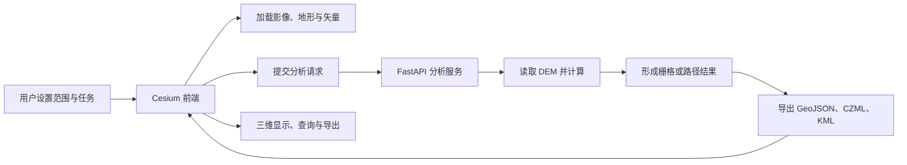

# Cesium 三维地理信息系统完整源码分析与越野算法接入方案

**分析日期：** 2026-08-10  
**分析范围：** `D:\VS_Code_Program\CesiumJS_Debug` 现有源码、配置、数据目录、模型、实验和测试文件  
**操作边界：** 本次只读取原工程；除本分析目录外，没有修改、移动或删除任何工程文件。

---

## 一、先给结论

这套工程已经具备一个三维地理信息分析平台的主体框架，能够完成多源数据加载、Cesium 三维显示、图层管理、绘制与量测、地形分析、剖面分析、部分地貌分类、分析任务提交、结果加载和结果导出。它不是只为越野路径规划编写的单一程序，而是可承载多种地理信息处理算法的前端平台与分析服务框架。

越野通行能力算法目前还没有形成一条完整且唯一的正式计算流程。工程中同时存在：

1. **前端旧版流程：** 浏览器直接采样地形，计算坡度、查表得到通行时间，再执行 A* 或 RRT 路径规划；
2. **后端原型流程：** FastAPI 读取 DEM，计算坡度、曲率和地形线特征，生成栅格代价值，再用 Dijkstra 算法搜索路径；
3. **地貌分类流程：** 使用规则、Geomorphons 或 ONNX 模型分类地貌，但分类结果尚未正式进入路径代价计算；
4. **独立实验流程：** `tests/dem-experiment` 中比较多种 DEM 方向代价公式，但尚未与平台正式算法统一。

因此，后续不需要推倒整个系统。应保留前端三维交互、图层管理、任务编排、分块加载、结果显示和导出能力，重点替换并统一后台的“环境数据—车辆响应—通行约束—路径代价—路径规划”计算核心。

### 当前可以确认的工程状态

| 内容 | 当前状态 | 说明 |
|---|---|---|
| Cesium 三维场景与数据加载 | 工程已实现 | 可加载影像、地形、矢量、三维模型、轨迹等数据 |
| 图层管理与三维交互 | 工程已实现 | 支持图层显示、透明度、顺序、定位和删除 |
| 地形分析与结果显示 | 工程已实现 | 已有坡度、坡向、曲率、剖面、粗糙度等功能 |
| 前后端分析任务联动 | 工程已实现 | 支持请求、分块、缓存、加载、终止和清理 |
| DEM 方向性通行代价 | 工程原型 | 已有方向计算，但路径搜索没有保留每个行驶方向的代价 |
| 土地覆盖代价 | 实验代码 | 通过固定速度系数修正坡度代价，参数来源未记录 |
| 土壤、含水量和承载力 | 尚未接入正式流程 | 现有主流程没有完整的土壤响应计算 |
| 障碍物、水系和道路约束 | 部分实验代码 | 有人工绘制水域、道路和土地类型覆盖，但没有统一后台数据模型 |
| 车辆能力约束 | 尚未形成统一模型 | 前端保留若干车辆运动学试验函数，后端路径接口没有车辆参数 |
| 综合通行能力模型 | 尚未完成 | 现有后端主要是 DEM 几何代价，不是完整车辆—地形—土壤模型 |
| 路径规划验证 | 基础测试 | 有界面冒烟测试和合成 DEM 实验，缺少正式数值验证与端到端验证 |

---

## 二、工程总体结构

### 2.1 实际运行结构



主页面是：

`cesium_old/Cesium_coordinate_copy_czDebugging.html`

后端入口是：

`backend/app/main.py`

工程采用“静态网页 + Python 分析服务”的方式运行。前端没有使用统一模块打包，多个脚本通过全局变量互相调用，因此主页面中的脚本加载顺序直接决定功能能否工作。该约束已在工程的 `AGENTS.md` 中明确记录。

### 2.2 目录及其作用

| 目录 | 主要内容 | 在系统中的作用 |
|---|---|---|
| `cesium_old` | 主页面、Cesium 库、界面脚本、地形和路径功能、示例数据 | 三维前端和旧版浏览器计算 |
| `backend` | FastAPI 接口、DEM 分析、路径规划、地貌分类、结果导出 | 后台分析服务 |
| `tests` | Playwright 界面测试、DEM 代价实验、调试脚本 | 自动测试和研究实验 |
| `models` | ONNX、PyTorch 模型和训练数据 | 地貌分类模型资产 |
| `earthscape` | 外部地表地质分类项目和独立运行环境 | 研究参考与可能的训练资产，当前未接入主系统 |
| `literature` | 研究文档、算法讨论、流程图 | 研究记录和设计材料 |
| `envirment` | GeoServer 及其数据目录 | 历史或备用服务环境，当前主流程未发现明确依赖 |
| `mcp`、`skills` | 工具配置和研究辅助脚本 | 开发与研究支持 |

---

## 三、系统功能分类

现有功能可以归纳为六类。这样分类后，越野通行能力只是“专题分析与路径规划”中的一个应用，不会遮盖平台已有的其他遥感和三维地理信息能力。

### 3.1 数据与场景管理

- 加载地形、影像和 TIFF 数据；
- 加载 GeoJSON、KML/KMZ、CZML；
- 加载 3D Tiles、glTF/GLB；
- 加载轨迹和动态模型；
- 按图层管理显示、透明度、顺序和删除；
- 地名或坐标搜索与场景定位。

### 3.2 三维交互与测绘工具

- 点、线、面绘制；
- 距离、面积等量测；
- 分析范围和起终点选取；
- 鼠标悬浮查看分析结果数值；
- 场景保存和窗口组件管理。

### 3.3 地形与空间分析

- 坡度、坡向和曲率；
- 等高线；
- 地形剖面；
- 地形粗糙度和高程变化；
- 山脊线、山谷线等地形结构试验；
- 通视或视域相关功能。

### 3.4 分类与遥感专题显示

- 基于规则的地貌分类；
- 基于 Geomorphons 的地貌分类；
- 基于 ONNX 模型的地貌分类；
- 土地覆盖矢量叠加及类型显示；
- 分类结果在 Cesium 中分区显示和查询。

### 3.5 越野通行与路径规划

- 坡度—速度查表得到单栅格通行时间；
- 土地覆盖速度系数修正；
- 人工绘制道路和水域限制；
- A* 网格搜索；
- RRT 快速扩展随机树搜索；
- 后端 Dijkstra 最短路径；
- 路径剖面、粗糙度和高程变化统计。

### 3.6 分析服务与结果输出

- DEM 元数据读取；
- 分析任务提交、取消、分块和缓存；
- GeoJSON、CZML、KML 输出；
- 结果自动加载到 Cesium；
- 输出目录和瓦片缓存清理。

---

## 四、三条现有计算流程

### 4.1 浏览器内的旧版地形与路径流程


这条流程主要位于：

- `features/slope/SlopeAspect copy debug.js`
- `features/slope/modules/SlopeAspectGridModule.js`
- `features/slope/modules/SlopeAspectCostModule.js`
- `features/slope/Override_Draw_Load.js`
- `features/slope/PathPlanning_RRT.js`

坡度代价模块把坡度映射为速度，再用“栅格移动距离 ÷ 速度”计算时间。代码中的速度节点为 25、20、15、12、8、5、0 km/h，对应坡度 0、3、6、10、15、20、30 度。该方法的输出单位可以解释为秒，但源码没有记录这套坡度—速度关系对应哪一种车辆、地面、轮胎和试验来源，因此目前只能视为实验参数，不能直接作为正式车辆通行模型。

土地覆盖模块把不同类型设为速度系数，例如森林 0.4、草地 0.85、湿地 0.3、水域 0，并按“原通行时间 ÷ 速度系数”修正结果。其优点是计算简单，缺点是参数来源未记录，而且把地表覆盖的所有作用都压成一个速度比例，无法区分滚动阻力、牵引力不足、陷车和硬障碍等不同机制。

### 4.2 后端 DEM 分析与路径流程


这条流程主要位于 `backend/app/services/analysis_service.py`。地形分析阶段确实计算了八个相邻行驶方向的候选代价，但最终只保留每个栅格中的最小值。随后 `plan_path()` 使用这个单值栅格搜索路径，边代价为：

> 网格步长 × 目标栅格的单值代价

这会产生一个关键问题：从同一栅格向东、向西、上坡、下坡或横切坡面时，路径搜索看到的是同一个值。也就是说，地形分析阶段计算过方向差异，但路径搜索阶段没有保留这项差异。

此外，`plan_path()` 调用 `analyze_terrain()` 时没有传入起终点，进一步说明当前路径接口实际没有使用分析函数中的起终点方向约束。

### 4.3 地貌分类流程


后端分类函数还会形成一份 `cost_adjustment`，即每个地貌类别对应的代价调整系数。但现有接口主要输出类别和置信度，没有把这份系数送入正式地形代价或路径规划流程。因此，当前地貌分类是可显示的独立专题结果，还不是通行代价模型中的正式输入。

---

## 五、前端架构分析

### 5.1 主页面与脚本组织

主页面直接加载 Cesium、ECharts、jQuery、Bootstrap、Turf、GeoTIFF、ONNX Runtime Web、Vue 和 Element Plus。后续再依次加载场景初始化、图层管理、数据加载、地形分析、路径规划和分类脚本。

这种结构的优点是便于快速添加功能，缺点是：

- 文件之间大量依赖 `window` 和全局对象；
- 同一功能的新旧版本可能同时存在；
- 脚本顺序变化可能使功能失效；
- 很难单独测试一个算法模块。

因此，接入新越野算法时不宜继续把核心公式分散进多个前端脚本。前端应负责参数输入、任务提交、进度显示和结果展示；正式计算应集中在后端服务。

### 5.2 可以直接复用的前端能力

| 能力 | 主要文件 | 接入新算法时的用途 |
|---|---|---|
| Cesium 场景 | `features/earthOpera.js` | 显示研究区、数据、代价图和路径 |
| 图层管理 | `features/SidebarManager.js` | 管理 DEM、土地覆盖、土壤、约束、代价和路径图层 |
| 全局事件 | `features/eventBindInit.js` | 连接菜单、窗口和分析任务 |
| 范围绘制 | `features/slope/CreatePolygonOnGround.js` | 选择研究范围 |
| 后端联动 | `features/slope/TerrainBackendIntegration.js` | 请求、分块、缓存、终止、结果加载 |
| 剖面分析 | `features/slope/TerrainProfileAnalysis.js` | 显示路径高程、坡度和距离变化 |
| 粗糙度分析 | `features/slope/RoughAnalysis.js` | 补充路径地形统计 |
| 结果渲染 | GeoJSON/CZML/KML 加载模块 | 显示代价图、约束区和路径 |

### 5.3 前端需要整理的部分

1. 明确一个正式入口，旧版坡度代价、旧版车辆函数和实验路径算法不再与正式后端结果混用；
2. 将车辆、数据版本、研究范围、起终点和计算情景组成一次完整任务，而不是散落在不同窗口；
3. 结果图层必须显示单位和含义，例如“单位距离机械功 J/m”“预计通行时间 s”“不可通行原因”，不能只显示“cost”；
4. 代价图与路径结果应同时记录参数情景编号，避免重新计算后无法知道使用了哪套数据和车辆参数；
5. 把硬编码的 Cesium Ion 访问令牌移到本地配置或环境变量，避免源码公开后被他人使用。

---

## 六、后端架构分析

### 6.1 已提供的接口

| 接口 | 作用 |
|---|---|
| `GET /api/v1/formats` | 返回支持的分析类型和输出格式 |
| `GET /api/v1/dem/meta` | 读取 DEM 范围、坐标系和有效性 |
| `POST /api/v1/analyze/terrain` | 计算坡度、坡向、曲率或现有地形代价 |
| `POST /api/v1/analyze/path` | 执行现有 Dijkstra 路径搜索 |
| `POST /api/v1/analyze/classify` | 执行地貌分类 |
| `POST /api/v1/analyze/classify/stream` | 流式返回分类进度 |
| 两个缓存清理接口 | 清理输出文件和瓦片缓存 |

请求结构已支持分析范围、分辨率、DEM 文件、DEM 解码方式、起终点和输出格式。这部分可以扩展为新算法接口，不必重写整个任务系统。

### 6.2 后端结果与文件流向

1. 前端提交分析请求；
2. 后端读取本地 DEM 或生成测试 DEM；
3. 后端形成规则数组；
4. 分析服务计算数值结果；
5. 导出服务写入 GeoJSON、CZML 或 KML；
6. 后端返回可访问的文件地址；
7. 前端加载文件并加入图层管理。

输出采用临时文件再重命名的方式，可以避免前端读取到未写完的 JSON。这个设计应保留。

### 6.3 后端当前依赖缺口

`backend/requirements.txt` 只列出了 FastAPI、Uvicorn、NumPy、Rasterio、Pydantic 和文件上传组件。实际分类和自动 DEM 下载代码还会调用 `dem_stitcher`、`whitebox` 和 `onnxruntime`。如果只按依赖文件安装，相关功能可能无法启动。因此应把“基础运行依赖”和“地貌分类可选依赖”分别列清楚。

---

## 七、现有算法中需要优先修正的问题

### 7.1 路径搜索丢失了行驶方向

**代码事实：** 地形分析计算多个相邻方向，最后把它们压成每个栅格一个最小值；路径规划只读取这个单值栅格。

**产生的影响：** 同一个坡面上，上坡、下坡和横向行驶的代价可能相同。对需要方向敏感的车辆通行模型，这是结构性错误，不是调权重能够解决的问题。

**修正方式：** 每个栅格必须保存八个方向的边代价，或者在搜索时根据“当前格—相邻格”的方向现场计算。数据结构应是 `行 × 列 × 8 个方向`，而不是 `行 × 列` 的单值图。

### 7.2 无数据区域被平均高程填补

**代码事实：** DEM 重采样出现 NaN 后，用整个区域的平均高程填补。

**产生的影响：** 数据边界、空洞或水体可能被填成一块平坦地形，路径有机会穿过本来未知或无效的区域。

**修正方式：** 无数据区域单独形成有效性掩膜。正式路径搜索默认不得进入；只有用户明确选择插值并记录插值方法时，才生成补值数据。

### 7.3 搜索失败后返回直线

**代码事实：** 后端没有找到路径时，生成 64 个线性插值点供 Cesium 显示。

**产生的影响：** 用户会看到一条路线，但它没有经过通行约束和最短路径计算，可能直接穿过障碍物。

**修正方式：** 搜索失败必须返回明确的失败状态、原因和已搜索范围，不得生成候选路线。

### 7.4 距离换算在高纬度区域会偏大

**代码事实：** 路径长度统计把经度差和纬度差都乘 111320 m，没有给经度乘纬度余弦。

**产生的影响：** 东西方向距离会被高估，雅江等中纬度区域也会出现系统误差。

**修正方式：** 统一使用投影坐标计算，或至少使用 `经度差 × 111320 × cos(纬度)`。

### 7.5 前端旧版 `GetCost()` 的含义冲突

**代码事实：** `slopeCost` 在坡度模块中表示通行时间，数值越大越困难；旧版路径函数却把它当作“数值越大越容易通行”并放在分母。

**产生的影响：** 困难栅格的时间越大，路径函数中反而可能越便宜。

**修正方式：** 旧版函数只保留为历史实验，不作为正式路径接口。正式模型统一在后台按明确单位计算。

### 7.6 土地覆盖参数没有来源记录

固定速度系数可以作为一个简单基线，但不能直接充当正式模型。每个类别需要记录数据分类体系、车辆、地表状态、参数来源、单位和适用条件。否则换一份土地覆盖数据或换一辆车，`gridcode` 和系数可能同时失效。

### 7.7 地貌分类尚未进入正式通行模型

分类服务虽然计算了类别代价系数，但主代价和路径接口没有使用。地貌类别本身也不应直接等同于车辆代价；它更适合用于选择后续地形参数、描述研究区或辅助分区统计。

### 7.8 当前自动化测试不足以证明算法正确

现有 Playwright 测试主要验证页面和方法存在，缺少：

- DEM 坡度和方向计算的已知答案测试；
- 无数据、边界、水体和不可通行区测试；
- 八方向边代价测试；
- 路径搜索失败测试；
- 前端提交任务到后端返回图层的完整测试；
- 同一输入与固定参数是否得到相同结果的复现测试。

---

## 八、独立实验和模型资产的真实作用

### 8.1 DEM 方向代价实验

`tests/dem-experiment` 使用合成平面、锥体、鞍部和山脊—山谷地形比较多种代价公式。这类实验能检查公式是否产生预期的方向变化，但不能证明某个模型在真实越野行驶中更准确。

现有一次报告中，本文候选方法的总数值和累计爬升并没有稳定优于简单方法。更重要的是，各方法使用不同的代价定义，直接比较各自的“总代价数值”没有统一物理意义。后续应在同一评价指标下比较，例如：

- 是否违反车辆坡度、侧倾或土壤承载约束；
- 路径长度；
- 机械功或能量；
- 预计时间；
- 已知道路或公开路线的空间一致性；
- 对参数变化的稳定性。

### 8.2 地貌 ONNX 模型

工程中的地貌模型采用 8 类输出。训练脚本既能生成合成地貌，也能下载公开 DEM 后使用 Geomorphons 生成类别标签。后者本质上是让神经网络学习另一个算法的输出，并不是人工实测真值。

训练记录中的 76% 验证准确率只能说明模型对当前训练/验证拆分的复现能力。由于样本随机拆分和类别重复采样可能使相近空间块或重复样本同时进入训练集和验证集，它不能直接证明模型能迁移到雅江或其他地区。

### 8.3 EarthScape

`earthscape` 是一个地表地质制图研究工程，包含 LiDAR DEM、航空影像和多尺度特征。它的类别体系、研究区和任务与当前 8 类地貌分类不同。当前没有发现它被主页面或后端 API 调用，因此应视为独立研究资产，而不是已运行的系统模块。

---

## 九、越野通行能力算法的正确接入结构

### 9.1 总体处理顺序

新算法应遵循下面的计算顺序：


其中，“按边计算”指计算车辆从当前栅格移动到某个相邻栅格的代价。同一栅格朝不同方向移动时，纵坡、横坡、距离、土壤响应和障碍关系都可能不同。

### 9.2 正式输入

| 输入组 | 最低必要数据 | 说明 |
|---|---|---|
| 任务 | 研究范围、起点、终点、网格大小、任务目标 | 定义一次可复跑计算 |
| 地形 | DEM、坐标系、分辨率、无数据值 | 计算距离、行驶方向、纵坡和横坡 |
| 地表 | 土地覆盖类别及分类体系 | 选择地表参数或形成限制条件 |
| 土壤 | 土壤类型、含水情景或可获得的强度参数 | 计算滚动阻力、牵引和陷车条件 |
| 障碍 | 水系、建筑物、岩体等可通行/不可通行信息 | 形成硬约束或附加通过条件 |
| 道路 | 道路中心线、等级或表面类型 | 作为可选地表分支，不自动视为真值路径 |
| 车辆 | 质量、轮胎、轴数、尺寸、离地间隙、坡度和侧倾限制等 | 把环境条件转换为车辆响应和约束 |
| 参数来源 | 参数版本、来源、适用条件和不确定范围 | 确保结果可解释、可复跑 |

### 9.3 正式中间数据

每个网格、每个行驶方向至少要保存：

1. 相邻栅格距离，单位 m；
2. 行驶方向，单位 °；
3. 纵坡角和横坡角，单位 °；
4. 地表类别和土壤状态；
5. 是否允许进入；
6. 不允许进入的原因，例如坡度超限、水体、障碍物或数据缺失；
7. 车辆牵引需求、滚动阻力或其他采用的有单位响应；
8. 单步机械功或能量，单位 J；
9. 单步预计时间，单位 s；
10. 参数不确定范围或结果等级。

不能把这些量过早压成一个没有单位的“综合分数”。安全能力优先作为约束；能够通过以后，再比较能量、时间或其他任务目标。

### 9.4 推荐的数据结构

```text
任务情景
├─ 情景编号
├─ 输入数据版本
├─ 车辆参数版本
├─ 计算网格
│  ├─ 高程与有效性
│  ├─ 土地覆盖
│  ├─ 土壤状态
│  └─ 障碍与道路
├─ 八方向边数据
│  ├─ 方向与距离
│  ├─ 纵坡与横坡
│  ├─ 可通行标志与原因
│  ├─ 能量
│  └─ 时间
└─ 路径结果
   ├─ 路径节点
   ├─ 分段计算值
   ├─ 总长度、总能量和总时间
   └─ 约束检查与结果说明
```

### 9.5 接口建议

保留现有 API 风格，新增或升级为三步：

1. **建立计算情景：** 检查数据范围、坐标、分辨率、车辆和参数来源；
2. **生成通行结果：** 输出不可通行区、八方向代价和便于显示的汇总图；
3. **执行路径规划：** 读取同一情景中的八方向边数据，输出路径和分项统计。

用于显示的二维代价图可以取某个固定行驶方向、到目标方向或方向统计值；但它只是可视化结果，路径搜索必须读取完整的方向边数据。

---

## 十、哪些部分保留，哪些部分替换

| 现有部分 | 处理建议 | 理由 |
|---|---|---|
| Cesium Viewer 和导航 | 保留 | 已形成稳定三维场景入口 |
| 图层管理 | 保留并扩展 | 可以管理新数据和新结果 |
| 范围、起终点绘制 | 保留 | 符合路径任务需要 |
| 后端请求、取消、分块、缓存 | 保留 | 是可复用的工程骨架 |
| GeoJSON/CZML/KML 路径输出 | 保留 | 适合矢量路线和小规模结果 |
| 大栅格以逐格 GeoJSON 输出 | 改为栅格输出 | 高分辨率时文件过大，应使用 GeoTIFF/COG 等栅格格式 |
| 前端坡度—速度表 | 保留为基线 | 可用于方法对比，不能作为未说明车辆的正式模型 |
| 土地覆盖固定速度系数 | 保留为基线 | 便于与新方法比较，但参数需登记来源 |
| 前端旧版 `GetCost()` | 停止用于正式结果 | 代价含义相互冲突 |
| 后端单值 `cost` 栅格 | 替换 | 无法表达方向性 |
| Dijkstra 主循环 | 可复用框架 | 改为读取边代价后仍可正确使用 |
| 无数据均值填补 | 替换 | 可能制造虚假通路 |
| 失败时直线结果 | 删除 | 会把失败伪装成路线 |
| 地貌分类显示 | 保留 | 可用于地貌专题图和辅助统计 |
| 地貌固定代价系数 | 暂不进入主模型 | 尚无本地标定和完整来源 |
| 独立 ONNX 模型 | 作为试验模块 | 需空间独立验证后再决定是否进入正式流程 |

---

## 十一、建议的实施顺序

### 第一阶段：统一任务和参数

1. 建立一份“参数与来源列表”；
2. 定义车辆参数文件、环境数据清单和情景编号；
3. 明确所有输入的单位、坐标系、分辨率和无数据值；
4. 选定正式后端为唯一计算入口，前端旧算法只保留为对照。

**完成标志：** 任意一张代价图或路径都能追溯到输入文件、车辆参数和情景编号。

### 第二阶段：建立统一计算网格

1. 对 DEM、土地覆盖、土壤、道路和障碍进行坐标转换与对齐；
2. 保留每类数据的原始有效性掩膜；
3. 对分类数据使用最近邻重采样，对连续数据按其含义选择重采样方法；
4. 输出数据覆盖统计和缺失区域图。

**完成标志：** 不同数据可以逐格对应，且不会把无数据区域自动变成可通行区。

### 第三阶段：实现八方向车辆响应

1. 从 DEM 计算每个相邻方向的距离、纵坡和横坡；
2. 接入土壤和地表响应；
3. 接入水体、障碍物、坡度、侧倾等约束；
4. 输出每条边的可通行状态、能量和时间。

**完成标志：** 同一栅格不同方向可以得到不同且可解释的计算结果。

### 第四阶段：接入路径规划

1. 修改 Dijkstra 或 A*，使其读取八方向边代价；
2. 搜索失败返回失败原因；
3. 输出路径每一段的计算明细；
4. 使用投影坐标计算距离。

**完成标志：** 路径统计等于各分段结果之和，并且不穿过任何硬约束区域。

### 第五阶段：接入三维显示

1. 在前端增加统一任务窗口；
2. 显示输入数据、不可通行区、代价图和候选路径；
3. 悬浮提示显示量名、数值和单位；
4. 路径剖面同时显示高程、纵坡、横坡、能量和时间；
5. 支持不同方法在同一场景内显示和比较。

**完成标志：** 用户能从一次任务中看清输入、计算过程、限制原因和路径结果。

### 第六阶段：测试和验证

1. 用已知平面验证方向坡度；
2. 用人工障碍图验证不可通行约束；
3. 用上坡、下坡和横坡场景验证方向差异；
4. 用简单基线、AHP/加权基线和候选方法比较；
5. 用多组起终点统计长度、搜索节点数、时间、能量、坡度和约束违例；
6. 固定输入和参数，验证结果可重复。

**完成标志：** 每项主要结论都对应一个明确指标和可复跑实验。

---

## 十二、建议优先处理的十项工作

1. 后端路径搜索改为八方向边代价；
2. 删除路径失败时的直线回退；
3. 建立无数据掩膜和不可通行原因；
4. 修正路径距离计算；
5. 建立统一情景编号和参数与来源列表；
6. 把土地覆盖、土壤、障碍物和车辆输入加入后端请求模型；
7. 统一新算法输出的单位和字段；
8. 将大范围栅格结果改为 GeoTIFF/COG，路径继续使用 GeoJSON；
9. 补全后端依赖和算法数值测试；
10. 前端只保留一个正式越野任务入口，旧算法明确标为对照实验。

---

## 十三、源码证据索引

以下位置是本报告主要判断的直接依据。

| 判断 | 文件和位置 |
|---|---|
| 主页面和脚本加载顺序 | `cesium_old/Cesium_coordinate_copy_czDebugging.html:1262-1375` |
| Cesium Viewer 和访问令牌 | `cesium_old/features/earthOpera.js:45-48` |
| 图层管理入口 | `cesium_old/features/SidebarManager.js:19-49, 444, 940, 1160` |
| 后端接口 | `backend/app/main.py:242-279, 502, 642, 867` |
| 后端请求结构 | `backend/app/schemas.py:20-106` |
| DEM 无数据均值填补 | `backend/app/services/analysis_service.py:560-586` |
| 地形分析入口 | `backend/app/services/analysis_service.py:648-715` |
| 路径规划没有传起终点到地形分析 | `backend/app/services/analysis_service.py:748-779` |
| 路径只使用单值栅格代价 | `backend/app/services/analysis_service.py:791-805` |
| 失败时生成直线 | `backend/app/services/analysis_service.py:807-815` |
| 经度距离未乘纬度余弦 | `backend/app/services/analysis_service.py:822-833` |
| 前端坡度—速度查表 | `cesium_old/features/slope/modules/SlopeAspectCostModule.js:33-54` |
| 前端代价颜色分级 | `cesium_old/features/slope/modules/SlopeAspectCostModule.js:159-180` |
| 土地覆盖速度系数 | `cesium_old/features/slope/Override_Draw_Load.js:182-191, 509-514` |
| 前端旧版代价含义冲突 | `cesium_old/features/slope/SlopeAspect copy debug.js:770-811` |
| 分类代价系数只在分类模块形成 | `backend/app/services/terrain_classifier.py:115-119, 215-220, 333-339` |
| 后端安装依赖清单 | `backend/requirements.txt:1-6` |

---

## 十四、本次分析的结论边界

- 本报告根据当前工作区源码和文件结构判断“已经编写什么”和“代码当前怎样连接”；
- 没有实际启动全部服务、打开全部大数据或重新训练模型，因此不把“代码存在”等同于“全部功能已经通过运行验证”；
- 现有源码没有给出部分速度表、土地覆盖系数、地貌代价系数和分类阈值的文献来源，所以这些数值在本报告中只认定为工程中的实验参数；
- 新越野算法的具体物理公式、车辆参数和土壤参数仍应由研究阶段的文献推导、参数来源列表和实验共同确定。本报告解决的是平台怎样承载这些算法，以及现有实现中哪些结构会妨碍正确接入。

---

## 十五、最终判断

这套项目适合作为越野通行能力研究成果的最终三维显示和分析平台。最有价值的已有工作不是当前某一个代价公式，而是已经形成的 Cesium 数据显示、图层管理、任务交互、后端请求、分块缓存和结果加载链条。

下一阶段的主线应当是：以 FastAPI 后端作为唯一正式计算核心，建立带单位、带车辆参数、带数据来源、保留八个行驶方向的通行计算结果；在可通行约束通过以后，再以机械功、能量或时间作为路径优化目标；最后把不可通行区域、方向代价、路径和分项统计送回现有 Cesium 平台显示。

这样改造后，平台原有的遥感数据处理和三维地理信息功能可以继续保留，越野通行能力和路径规划则作为一套结构清楚、结果可解释、可替换车辆和研究区的专题分析服务接入其中。
